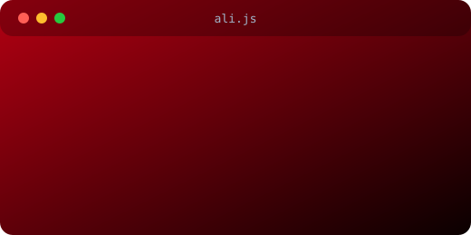

<div align="center">


<a href="https://github.com/aliqasimnasser1-afk">
  
</a>

<br/>


[](https://github.com/aliqasimnasser1-afk?tab=followers)

[](mailto:aliqasimnasser1@gmail.com)
[](https://aliqasimnasser1-afk.github.io)

</div>

---

## 👨‍💻 About Me

<div align="center">
  
</div>

```python
class AliQasim:
    role      = "Backend & Full-Stack Engineer"
    education = "B.Sc. Computer Science & IT"
    location  = "Medina, Saudi Arabia 🇸🇦"
    focus     = ["Backend development", "System architecture", "Performance"]
    learning  = ["DevOps", "Docker", "Cloud infrastructure"]
    mindset   = "Ship clean code. Solve real problems. Keep learning."

    def build(self):
        return "Reliable systems that businesses depend on"
```

- 🏢 Building production business platforms: **authentication, HR, finance, and fleet/cars** systems
- 🤖 Creating Python automation and Telegram bots in my spare time
- 📈 **580+ contributions** in the last year, with 200+ merged pull requests in a single month
- 🧠 Always exploring better architecture, cleaner APIs, and faster systems

---

## 🛠 Tech Arsenal

<div align="center">

**Languages**


**Tools & Platforms**


</div>

---

## 💼 What I Offer

<table>
<tr>
<td align="center" width="25%">🔌<br/><b>REST APIs</b><br/><sub>Clean, secure backends</sub></td>
<td align="center" width="25%">🤖<br/><b>Telegram Bots</b><br/><sub>Python &amp; aiogram</sub></td>
<td align="center" width="25%">⚙️<br/><b>Automation</b><br/><sub>Scripts &amp; workflows</sub></td>
<td align="center" width="25%">🐳<br/><b>Dockerized Apps</b><br/><sub>Easy to ship &amp; run</sub></td>
</tr>
</table>

---

## 🚀 Featured Work

<table>
<tr>
<td width="50%" valign="top">

### 🏢 Business Platforms
Modular enterprise systems built as a team:

- 🔐 **Authentication** service
- 👥 **HR** management
- 💰 **Financial** module
- 🚗 **Cars / fleet** management

`API design` · `Role-based access` · `Pull-request workflow`

</td>
<td width="50%" valign="top">

### 🎬 VeloTok
Fast Telegram bot that downloads public TikTok videos, audio, and photo posts.

`Python` · `aiogram` · `yt-dlp` · `Docker`

</td>
</tr>
<tr>
<td colspan="2" valign="top">

### ✂️ [Cutwave](https://cutwave-rose.vercel.app)
Trim, compress, and extract audio from video right in the browser. Files never leave your device.

- ⚡ Fast cut without re-encoding, or frame-accurate precise cut
- 📦 Compress to a target size for WhatsApp, Discord, or Telegram
- 🎵 Extract audio to MP3, with volume control up to 300%
- 🚀 Hardware acceleration with WebCodecs, handles files of several GB
- 📱 Installable app that works offline on mobile and desktop

`Next.js` · `TypeScript` · `ffmpeg.wasm` · `WebCodecs` · `PWA`

</td>
</tr>
</table>

---

## 📊 GitHub Analytics

<div align="center">


</div>

### 🐍 Contribution Snake

<div align="center">

<picture>
  <source media="(prefers-color-scheme: dark)" srcset="https://raw.githubusercontent.com/aliqasimnasser1-afk/aliqasimnasser1-afk/output/github-snake-dark.svg" />
  <source media="(prefers-color-scheme: light)" srcset="https://raw.githubusercontent.com/aliqasimnasser1-afk/aliqasimnasser1-afk/output/github-snake.svg" />
  
</picture>

</div>

---

## 🧭 Currently

| | |
|---|---|
| 🔨 **Building** | New backend project |
| 📚 **Learning** | DevOps, Docker, cloud infrastructure |
| 🎯 **Goal** | Contribute to impactful products and open source |
| 💬 **Ask me about** | Python, backend design, automation |

---

## 💡 Dev Quote

<div align="center">


</div>

---

## 🤝 Let's Connect

<div align="center">

[](mailto:aliqasimnasser1@gmail.com)
[](https://github.com/aliqasimnasser1-afk)

*Open to collaboration, feedback, and new opportunities.*


</div>
